<h1 align="center">ITMO.Widgets</h1>

<p align="center">
  <strong>My ITMO, который вы заслужили</strong>
  <br />
  Расписание, зачётка, спорт и QR-пропуск ИТМО на Android и iPhone
</p>

<p align="center">
  <a href="https://github.com/alllexey-dev/ITMO.Widgets/releases"></a>
  <a href="https://github.com/alllexey-dev/ITMO.Widgets/releases"></a>
  
  
  <a href="LICENSE"></a>
</p>

<p align="center">
  <a href="#скачать"><strong>Скачать</strong></a> ·
  <a href="https://t.me/itmowidgets">Telegram</a> ·
  <a href="https://widgets.alllexey.dev">Сайт</a> ·
  <a href="https://widgets.alllexey.dev/privacy.html">Конфиденциальность</a>
</p>

Неофициальное приложение для студентов ИТМО: данные My ITMO и БАРС в одном месте, на главном экране и без пароля в приложении.

## Что умеет

- **Сегодня** — пара, на которую идти: аудитория, адрес и сколько осталось.
- **Расписание** — лента дней с изменениями и уведомлениями о переносах и отменах.
- **Зачётка** — баллы My ITMO, БАРС и таблиц преподавателей в одном списке, уведомления о новых оценках.
- **Спорт** — запись в одно касание, очередь на свободное место, секции с автозаписью.
- **QR-пропуск** — на «Сегодня», в виджете и шторке, в Пункте управления на iPhone; работает без сети.
- **Карта кампуса** — аудитория на своём этаже и маршрут до неё.
- **Виджеты** — пара, день, список пар и спорт на домашнем экране.
- **Друзья** — их расписание и где они сейчас; кто видит ваше, решаете вы.
- **Преподаватели** — отзывы студентов, ИИ-сводка и ссылки к предметам.
- **Устройства** — веб-версия, [агент](https://github.com/alllexey-dev/itmo-widgets-agent) и [MCP для ИИ-ассистентов](https://github.com/alllexey-dev/itmo-mcp) подключаются по QR.

## Скачать

| | Версия | Требования |
|---|---|---|
| **Android** | [2.3 beta 3](https://github.com/alllexey-dev/ITMO.Widgets/releases/tag/v2.3.0-beta.3): `arm64` для большинства телефонов, `armv7` для старых | Android 8.0+ |
| **iPhone** | [2.3 beta 3](https://github.com/alllexey-dev/ITMO.Widgets/releases/tag/v2.3.0-beta.3): `.ipa` без подписи | iOS 26.1+, AltStore, SideStore или Sideloadly |
| **Android, стабильная** | [2.2](https://github.com/alllexey-dev/ITMO.Widgets/releases/tag/v2.2) | Android 8.0+ |

- Бета ставится поверх 2.2 с сохранением данных; вернуться на 2.2 можно только переустановкой.
- На iPhone пока нет push-уведомлений, поэтому автозапись на спорт там работает только через [itmo-widgets-agent](https://github.com/alllexey-dev/itmo-widgets-agent).
- В Google Play приложения пока нет. Новые версии и ответы на вопросы — в [@itmowidgets](https://t.me/itmowidgets).

## Как выглядит

**Android**

<table>
  <tr><th>Сегодня</th><th>Расписание</th><th>Зачётка</th><th>Запись на спорт</th></tr>
  <tr><td><picture><source media="(prefers-color-scheme: dark)" srcset="docs/images/readme/android-today-dark.webp">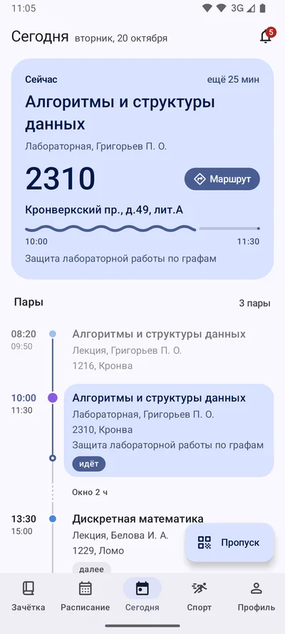</picture></td><td><picture><source media="(prefers-color-scheme: dark)" srcset="docs/images/readme/android-schedule-dark.webp">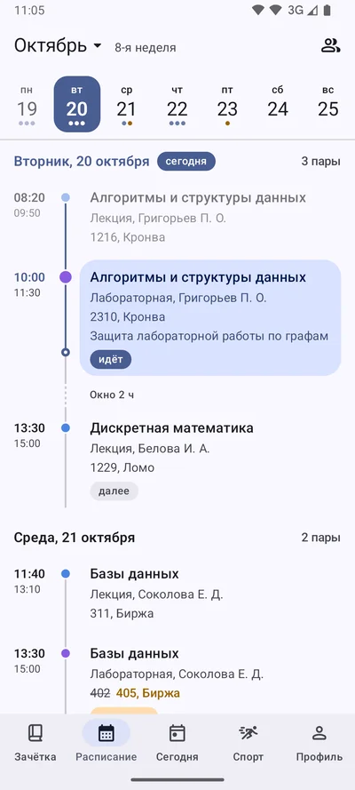</picture></td><td><picture><source media="(prefers-color-scheme: dark)" srcset="docs/images/readme/android-recordbook-dark.webp">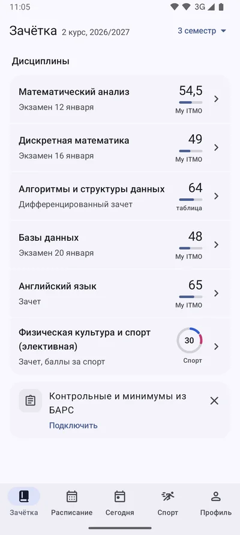</picture></td><td><picture><source media="(prefers-color-scheme: dark)" srcset="docs/images/readme/android-sport-dark.webp">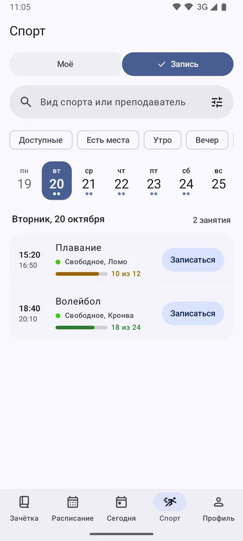</picture></td></tr>
</table>

**iPhone**

<table>
  <tr><th>Сегодня</th><th>Пара</th><th>Маршрут</th><th>Спорт</th></tr>
  <tr><td><picture><source media="(prefers-color-scheme: dark)" srcset="docs/images/readme/iphone-today-dark.webp">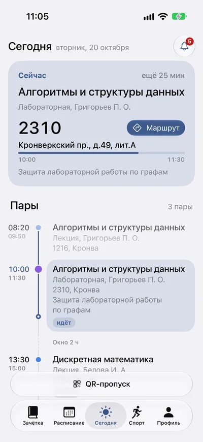</picture></td><td><picture><source media="(prefers-color-scheme: dark)" srcset="docs/images/readme/iphone-lesson-dark.webp">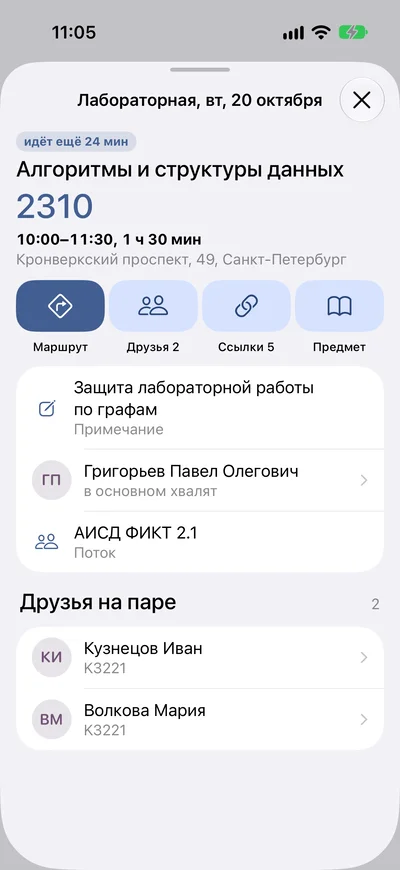</picture></td><td><picture><source media="(prefers-color-scheme: dark)" srcset="docs/images/readme/iphone-map-dark.webp">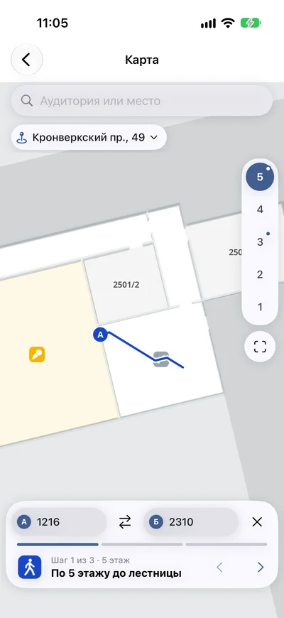</picture></td><td><picture><source media="(prefers-color-scheme: dark)" srcset="docs/images/readme/iphone-sport-dark.webp">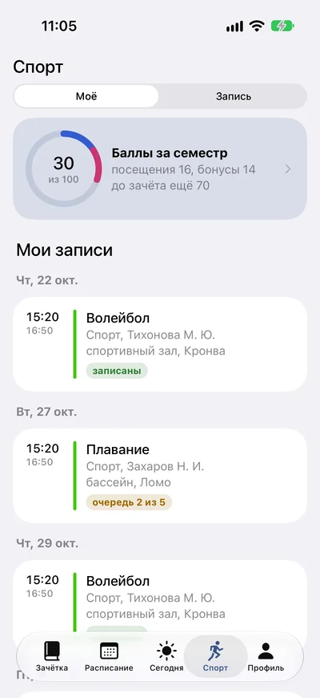</picture></td></tr>
</table>

**Виджеты**

<table>
  <tr><th>Пара</th><th>Спорт</th></tr>
  <tr><td><picture><source media="(prefers-color-scheme: dark)" srcset="docs/images/readme/widget-lesson-dark.webp">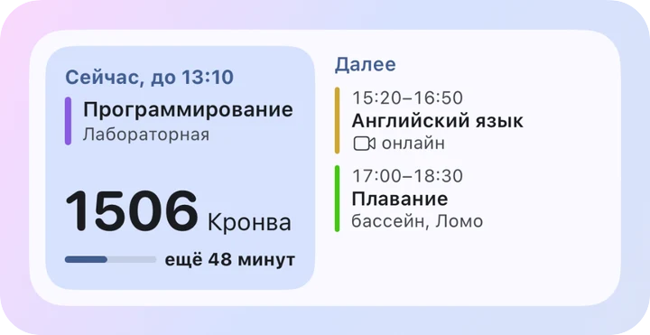</picture></td><td><picture><source media="(prefers-color-scheme: dark)" srcset="docs/images/readme/widget-sport-dark.webp">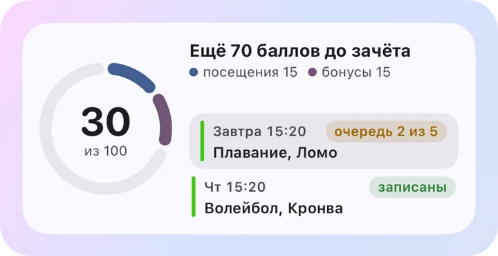</picture></td></tr>
  <tr><th>Расписание на день</th><th>Список пар</th></tr>
  <tr><td valign="top"><picture><source media="(prefers-color-scheme: dark)" srcset="docs/images/readme/widget-day-dark.webp">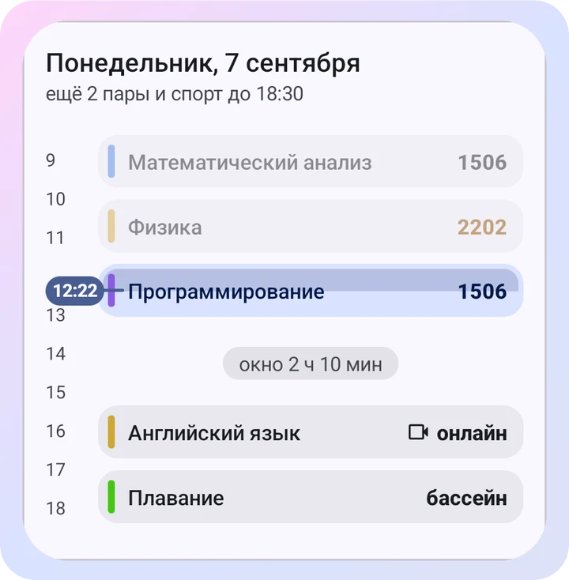</picture></td><td valign="top"><picture><source media="(prefers-color-scheme: dark)" srcset="docs/images/readme/widget-list-dark.webp">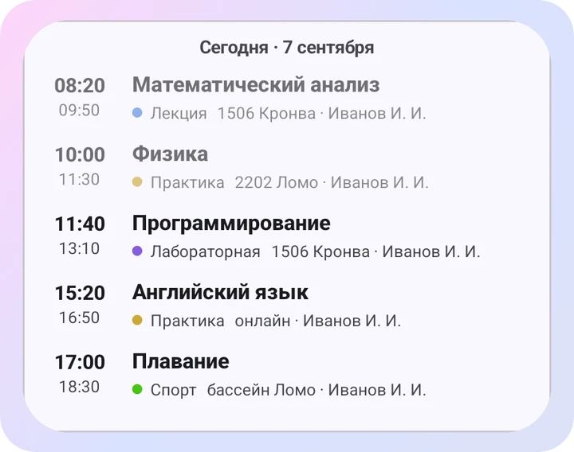</picture></td></tr>
</table>

<p align="center">
  
  <br />
  <sub>Из расписания — в карточку пары и по маршруту до аудитории</sub>
</p>

## Данные и приватность

- Вход через официальную страницу ITMO.ID: пароль приложение не видит.
- Расписание, зачётка и пропуск загружаются с My ITMO и БАРС прямо на телефон и хранятся там.
- Друзья, очереди на спорт, отзывы и подключённые устройства работают через сервер ITMO.Widgets и включаются отдельно.
- Рекламы и аналитики нет. Аккаунт на сервере можно [удалить](https://widgets.alllexey.dev/delete-account).

Подробно — в [«Как это работает»](docs/how-it-works/README.md) и [политике конфиденциальности](https://widgets.alllexey.dev/privacy.html).

<details>
<summary>Не открывается страница ITMO.ID</summary>

Войдите токеном через «Другие способы входа»:

1. Откройте [my.itmo.ru](https://my.itmo.ru/) в браузере на компьютере.
2. `F12` → **Application** → **Cookies** → `https://my.itmo.ru`.
3. Скопируйте значение `auth.refresh_token.itmoId` и вставьте его в приложении.

</details>

## Экосистема

| Репозиторий | Что делает |
|---|---|
| [itmo-widgets-backend](https://github.com/alllexey-dev/itmo-widgets-backend) | Сервер: друзья, приватность, очереди на спорт, уведомления |
| [itmo-widgets-web](https://github.com/alllexey-dev/itmo-widgets-web) | Сайт и веб-версия |
| [itmo-widgets-agent](https://github.com/alllexey-dev/itmo-widgets-agent) | Агент для компьютера или сервера: автозапись на спорт без телефона |
| [itmo-mcp](https://github.com/alllexey-dev/itmo-mcp) | MCP-сервер ИТМО для Claude, Codex, Cursor и других ассистентов |
| [my-itmo-api](https://github.com/alllexey-dev/my-itmo-api) | Java-клиент My ITMO и БАРС |

## Разработчикам

Kotlin Multiplatform: общая логика в `shared/`, Android на Compose в `app/`, iOS на SwiftUI в `iosApp/`.

- [Сборка и запуск](docs/getting-started.md), [тесты](docs/testing.md), [архитектура](docs/architecture.md), [вся документация](docs/README.md)
- [Правила для PR](CONTRIBUTING.md)

```bash
./gradlew verifyQuick      # тесты, Konsist, lint и debug-сборки (JDK 21)
scripts/ios/test.sh        # сборка и тесты iOS (Mac с Xcode)
```

## Обратная связь

Ошибки и идеи — в [Issues](https://github.com/alllexey-dev/ITMO.Widgets/issues) или [@itmowidgets](https://t.me/itmowidgets). К отчёту можно приложить «Журнал ошибок» из «Настройки → О приложении»: в нём нет токенов и личных данных.

## Лицензия

[MIT](LICENSE). Приложение не связано с Университетом ИТМО.
