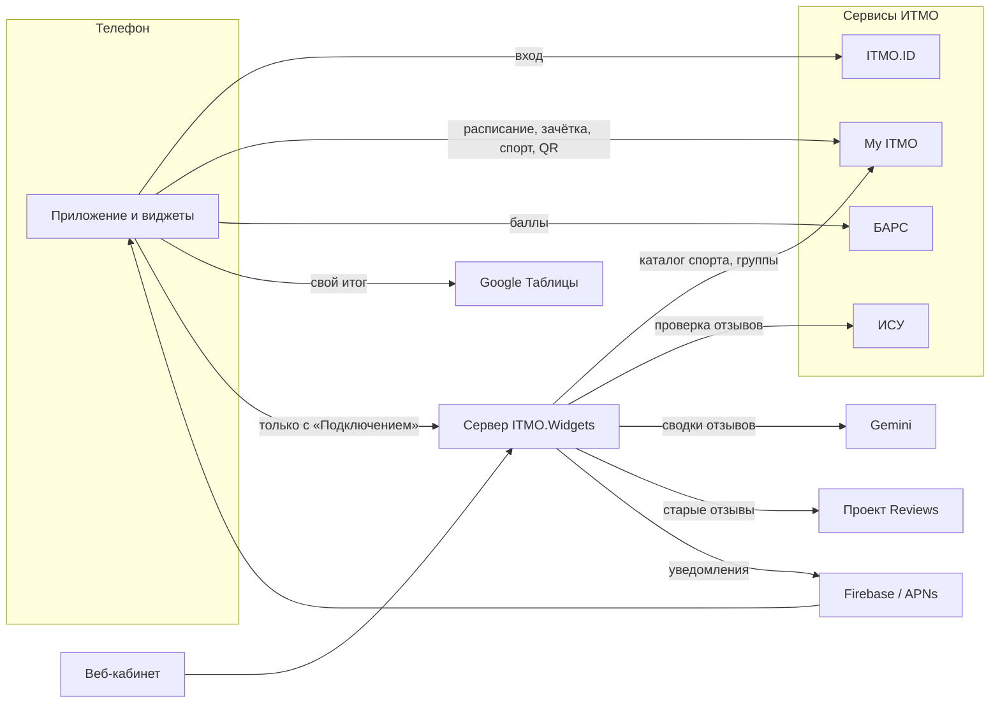

# Как работает ITMO.Widgets

Этот раздел объясняет, как устроен продукт: что получает студент, откуда
берутся данные и какие правила при этом соблюдаются. Он написан для студентов,
контрибьюторов и всех, кто не хочет читать код. Технические подробности — в
[справочнике для разработчиков](../README.md).

## Что делает приложение

ITMO.Widgets — неофициальное приложение для студентов ИТМО. Оно собирает в
одном месте то, что обычно разбросано по My ITMO, БАРС и чатам:

- расписание с виджетами на главном экране и уведомлениями об изменениях;
- зачётку с баллами My ITMO, БАРС и таблиц преподавателей;
- запись на спорт, очередь на свободное место и автозапись на будущие занятия;
- QR-пропуск в корпус — в приложении, в виджете и в шторке;
- друзей, их расписание и спорт с настройками приватности;
- ссылки и чаты предметов и отзывы о преподавателях.

На главной вкладке — лента на сегодня: пары, изменения в расписании, новые
оценки, спорт и заявки в друзья. Ненужные карточки скрываются в настройках.

## Из чего состоит экосистема

| Часть | Что делает |
|---|---|
| Android-приложение | основной клиент: экраны, виджеты, фоновые проверки, хранение данных на телефоне |
| iOS-приложение | тот же набор функций на общем коде; готовится к первому выпуску (2.3) |
| Сервер ITMO.Widgets | друзья, приватность, очереди на спорт, ссылки, отзывы, push-уведомления, вход на сайт |
| Веб-кабинет | сайт [widgets.alllexey.dev/app](https://widgets.alllexey.dev/app/): друзья, спорт, приватность, а для модераторов — модерация |
| MyItmoApi | наша открытая библиотека — единственный клиент My ITMO, БАРС и ITMO.ID |

## Откуда берутся данные

| Источник | Что даёт | Кто обращается |
|---|---|---|
| ITMO.ID | вход, токены доступа | телефон |
| My ITMO | расписание, зачётка, спорт, QR-пропуск, профили людей | телефон; сервер — только каталог спорта и учебные группы, своей служебной учётной записью |
| БАРС | баллы по контрольным точкам и оценки | телефон |
| ИСУ | проверка, вёл ли преподаватель у автора отзыва | сервер, служебной учётной записью |
| Google Таблицы | свой итог из публичной таблицы преподавателя | телефон |
| Проект Reviews | старые анонимные отзывы о преподавателях | сервер, раз в сутки |
| Gemini | краткая ИИ-сводка отзывов о преподавателе | сервер |
| Firebase и APNs | доставка push-уведомлений на Android и iPhone | сервер |

## Что остаётся на телефоне, а что уходит на сервер

Главный принцип — приватность по умолчанию. Всё, что можно сделать на
телефоне, делается на телефоне.

**Только на телефоне:**

- токены ITMO.ID и БАРС. Токен обновления (refresh token) никогда не покидает
  устройство и хранится в зашифрованном виде;
- расписание, зачётка, оценки, QR-пропуск и их кэши;
- проверки изменений расписания и новых оценок;
- подключённые Google Таблицы и найденная в них строка;
- синхронизация с календарём телефона.

**На сервере — только с «Подключением к ITMO.Widgets».** Это отдельный
переключатель, по умолчанию выключенный. Без него приложение не отправляет на
сервер ни одного запроса. С ним сервер хранит:

- номер ИСУ, имя, фото и учебные группы из ITMO.ID;
- друзей, заявки и настройки приватности;
- свои пары за открытые в приложении дни — чтобы их видели друзья, работали
  ссылки потока и проверка отзывов;
- записи и очереди на спорт;
- свои ссылки, отзывы, голоса и жалобы;
- токен уведомлений, модель телефона и версию приложения, сессии веб-кабинета.

Сервер узнаёт пользователя по короткоживущему токену доступа ITMO.ID: он
проверяет подпись токена и не сохраняет его. От имени пользователя сервер в
My ITMO не ходит — запись на спорт, например, делает сам телефон
([как устроена автозапись](sport.md)). Решения о доступе к чужим данным
принимает только сервер: приложение не может «подсмотреть» скрытое.

Выключение «Подключения» сразу останавливает обмен с сервером и отвязывает
телефон от уведомлений. Данные на сервере удаляются отдельно —
[удалением аккаунта](account-deletion.md).

## Разделы

- [Вход и аккаунт](account.md)
- [Расписание и его изменения](schedule.md)
- [Зачётка и баллы](grades.md)
- [Спорт и автозапись](sport.md)
- [QR-пропуск](qr.md)
- [Друзья и приватность](friends.md)
- [Отзывы о преподавателях](reviews.md)
- [Ссылки и чаты предметов](subject-links.md)
- [Уведомления](notifications.md)
- [Виджеты](widgets.md)
- [Веб-кабинет](web.md)
- [Демо-режим](demo.md)
- [Удаление аккаунта](account-deletion.md)
