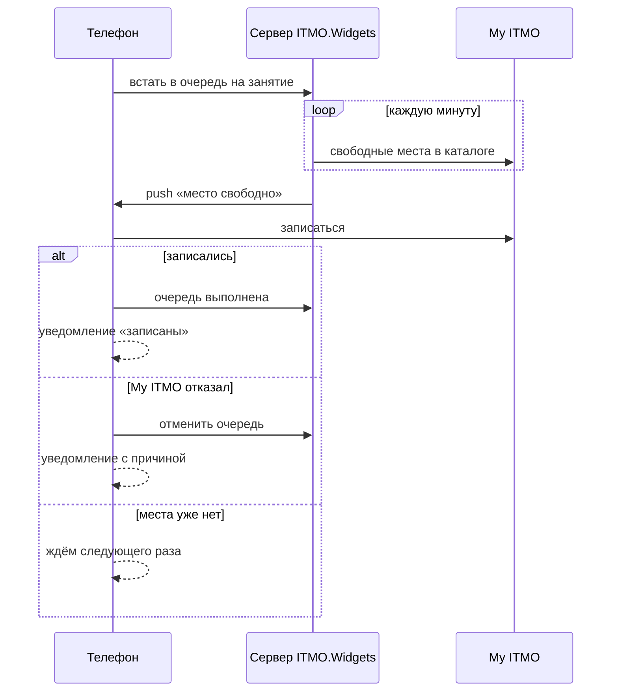

# Спорт и автозапись

## Что получает пользователь

Вкладка «Спорт» из двух частей, переключатель «Моё» / «Запись»:

- **«Моё»** — баллы за семестр кольцом (посещения плюс до 40 бонусных баллов),
  свои записи и очереди карточками по дням, как пары в расписании, и вход в
  «Мои секции».
- **«Запись»** — поиск по виду спорта и преподавателю, быстрые фильтры
  («Есть места», «Вечер», «Мои секции», «Друзья»), неделя, которая
  листается свайпом, и занятия дня плотными строками: время, секция, вид и
  корпус, заполненность «22 из 24», друзья и одно действие. Остальные фильтры —
  в шторке.
- **Шторка занятия** — сколько мест, одно главное действие и условия.
  Пересечение с парой показано оранжевой строкой и записаться не мешает.
- **«Мои секции»** — закреплённые секции (хранятся на телефоне) с ближайшими
  занятиями и лимитом очередей в подзаголовке.
- **«Откуда баллы»** — посещения плюс бонусы, бонусы в зачёт не больше 40,
  история начислений из My ITMO по месяцам. Прогноза нет: честно его не
  посчитать.

## Откуда данные

- Каталог занятий, записи, баллы и ограничения телефон читает из My ITMO сам.
  Запись и отмена — тоже прямые запросы телефона в My ITMO.
- Очереди, лимит автозаписи и записи друзей хранит наш сервер. Они работают
  только с «Подключением к ITMO.Widgets».
- Сервер сам следит за каталогом My ITMO своей служебной учётной записью:
  занятия обновляются каждые 10 минут, свободные места проверяются каждую
  минуту.

## Как работает очередь — от начала до конца

Главное: **записывает всегда телефон, а не сервер.** У сервера нет ваших
токенов My ITMO. Он только замечает подходящий момент и будит телефон
push-уведомлением.

1. Пользователь встаёт в очередь в приложении. Сервер запоминает, кто и на
   что ждёт; очередь — по времени постановки.
2. Когда в каталоге появляется свободное место, сервер выбирает первых в
   очереди и отправляет им push. На одно освободившееся место — одна попытка
   из обычной очереди.
3. Push будит приложение даже в фоне. Телефон записывается в My ITMO сам и
   показывает результат уведомлением.
4. Записались — очередь закрывается. My ITMO явно отказал (например,
   конфликт по времени или ограничение по здоровью) — очередь отменяется. Места
   уже нет — очередь ждёт дальше без уведомления.
5. Подтверждённые записи телефон отправляет на сервер, и тот закрывает
   очереди, которые уже выполнены.

**Правила и лимиты:**

- Попытки — не чаще раза в 15 минут, не больше 10 на одну очередь. Попытка
  тратится, только если у пользователя есть телефон, до которого дойдёт push.
- Обычная очередь на место закрывается за час до начала занятия. Для занятия
  в тот же день при постановке можно разрешить запись «в последний момент» —
  тогда очередь работает до конца занятия.
- Push живёт до момента, когда он ещё полезен: после дедлайна телефон его уже
  не получит.
- Push выполняет только тот аккаунт, для которого он отправлен: если на
  телефоне вошёл другой человек, push игнорируется.
- Гарантии «ровно один раз» нет: при сбое одна попытка может потеряться,
  следующая придёт через 15 минут.

## Автозапись на будущее

My ITMO публикует занятия примерно на две недели вперёд. Автозапись позволяет
занять место заранее:

1. Пользователь выбирает занятие, которое уже есть в каталоге, — образец.
2. Сервер запоминает его приметы: секцию, преподавателя, корпус, аудиторию,
   уровень, тип и время.
3. Когда в каталоге появляется занятие ровно через две недели с теми же
   приметами, сервер считает его целью и будит телефон, как в обычной
   очереди.
4. Если мест на всех желающих не хватает, оставшиеся автоматически переходят в
   обычную очередь на это занятие.

**Лимит:** 3 автозаписи. В лимит входят ожидающие автозаписи и те, по которым
за последние 30 дней уже была попытка. Отмена до первой попытки освобождает
место сразу.

Если занятие поменялось так, что приметы не совпадают, сервер ничего не
отправляет — он не переносит автозапись на другое занятие молча.

## Очередь через неделю

Пары повторяются раз в две недели, поэтому в «Моих секциях» задуман
переключатель «Очередь через неделю»: сервер запомнит занятие (секцию,
преподавателя, день недели, время и чётность недели) и сам встанет в очередь на
каждое такое занятие, как только его опубликуют. Пока сервер этого не умеет,
переключатель скрыт.

## Друзья и приватность

Записи и очереди видны друзьям по правилу «Кто видит спорт»: «Все», «Друзья»
(по умолчанию) или «Никто» ([приватность](friends.md)). Общие счётчики очереди
никогда не показывают, кто в ней стоит.

## Ограничения

- Без «Подключения» доступны каталог, запись и отмена, но не очереди и не
  записи друзей.
- В демо-режиме запись и очереди недоступны.
- На iPhone запись по push делает расширение уведомлений; без подписанной
  сборки push не приходят.
- Баллы «сколько засчитают» — формула приложения, а не официальное правило.

## Для разработчиков

- [Спорт](../features/sport.md), [уведомления](../features/notifications.md),
  [ссылки на занятия](../features/app-links.md)
- Серверная часть:
  [sport-automation.md](https://github.com/alllexey-dev/itmo-widgets-backend/blob/dev/docs/contracts/sport-automation.md)
